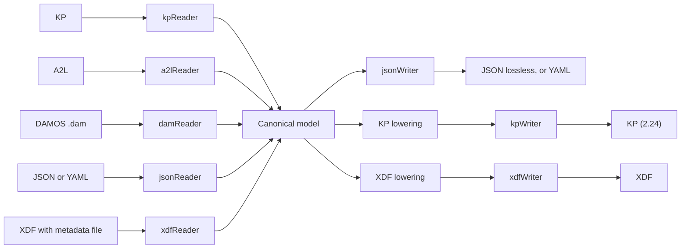

# Design: xdfkit, a map definition converter

Converts map definitions between WinOLS KP, A2L, DAMOS, TunerPro XDF and a canonical JSON/YAML model, and autocorrects KP files. Related docs: `model.md`, `format-matrix.md`, `kp-format.md`, `autocorrect.md`, `stamp-and-metadata.md`, `corpus.md`, `integrations.md`.

## Formats

- Outputs:
  - Canonical JSON: the shared model (`model.md`). No format-specific residue; KP-only fields come from a template KP or defaults.
  - YAML: the same model, node for node over the canonical JSON (typed numbers and stamp unchanged). No anchors, tags, or multiple documents.
  - KP (WinOLS 2.24): the lossless route into WinOLS (`kp-format.md`).
  - XDF (TunerPro XML 1.80): lossy alone; always written with `name.meta.json` so the pair is lossless (`stamp-and-metadata.md`). Optional comment embed is not implemented yet. Writer summary:
    - No XML declaration; ASCII with non-ASCII as `&#xNNNN;`; LF (TunerPro saves CRLF / XDF 1.80).
    - KP orientation kept; axis mirror not applied. `vislevel` on each table/constant (model level, or 2 when unmarked).
    - Linked image axes get `embedinfo type="3"` when a matching curve exists.
    - Add/subtract axes are live helpers by default; backwards is static labels; `--static-axes` forces labels (`stamp-and-metadata.md`, Live helpers; formulas in `kp-format.md`).
  - CSV map list (output only): ecuxplot mapdump format via `mapcsv/` (`xdfkit -f csv -i image -r ref`). Differences: axis columns follow organisation (`kp-format.md`); no-cell objects get `-`; 32-bit raw range masked; floats read as floats; display text is cleaned (`model.md`).
  - Edit stamp on every JSON output (model and metadata file): `stamp-and-metadata.md`.
- Inputs: KP headers 113, 116, 292, 329 (as ecuxplot mapdump); 245, 503, and 597 read-only (`kp-format.md`); A2L; DAMOS `.dam`; JSON/YAML; XDF with metadata file if present.
- No licensed WinOLS options assumed. Route into WinOLS is KP. No A2L or DAMOS writers (WinOLS import is one-way through the licensed Damos plugin).
- Readers: A2L (`a2l/`) then DAMOS (`dam/`). Both emit schema 1 with axes and conversions inlined and addresses as file offsets (`model.md`). A2L text is ISO-8859-1; DAMOS display text is CP850 except `0xB0` as degree (`°KW`).

## Implementation

- Go, pure (no cgo) in core packages and the CLI; only a planned C ABI library may use cgo.
- Core packages work on bytes: no file or console I/O, no `os.Exit`, no mutable globals.
- Façade: `api/` (`Convert`, `Merge`, `Verify`, `Lint`, `Fix`, `Version`, `Call`). Request/response: `go doc go.nyet.org/xdfkit/api`. The CLI is a client of `api`.
- Planned: `xdfkit rpc`, C ABI (`capi/`), WebAssembly. Licence: LGPL-3.0-or-later; `kp/` is a relicense of ecuxplot's `org.nyet.mappack`.
- CLI and `XXX2YYY` aliases: README and Makefile `ALIASES`. KP zip on 292+: pure Go deflate; round trip judged on the inflated block (`kp-format.md`).

## Merge

`xdfkit merge` folds a second definition into a base pack. Inputs: KP, XDF (with `.meta.json`), JSON or YAML. Provenance stays the base's. `--force` only replaces an existing output. `-n` reports without writing. Request fields: `go doc go.nyet.org/xdfkit/api MergeRequest`.

```
xdfkit merge [--smart] [--update] [--overwrite] [-n]
             [--description keep|fill|replace] [--comment keep|append|replace]
             [-f json|yaml|kp|xdf] [-i image] [--meta file] [--force]
             base [incoming] [output]
```

- Name match: `key` if set, else `id` (whole string). Blank key and blank id match nothing. `-` is a real id. Base key and id stay. A name match consumes the incoming object (not also appended on address mismatch). Repeated names are ambiguous for `--update`. Identical description/comment on every incoming object with that name applies to every base object with the name.
- Span match: same address, rows, cols, cell bits, and the same signed/endian/float, inverse, and image-axis address/bits/stored. A non-equal overlap stays two objects (`overlap`).
- `--update`: copies locator fields (address, shape, rows, cols, cell bits/signed, image-axis source/address/bits). Leaves conversion, precision, units, view, min/max, endian, float, axis stored/signed. Reports `default` where incoming differs. Empty units do not clear the base; differing non-empty units are `units`. Factor 1 is not written. Existing maps keep categories. `--overwrite` replaces the whole object except base key and id.
- `--description` / `--comment` override the mode default and do not copy layout. Default without `--update`/`--overwrite`: `keep`. `--update` fills empty description and appends new comment lines. `--overwrite` replaces both when incoming text is non-empty.
- `--smart`: fold by span before the name pass. Same display with different categories → one object (union). Different display at the same raw layout → alternate (`model.md`).
- New names appended; generator defaults on new maps reported `default`. Base names missing from incoming: `missing`. Report actions: `added`, `kept`, `corrected`, `description`, `comment`, `units`, `default`, `missing`, `ambiguous`, `overlap`, `categories`, `alternate`, `overwritten`, `skipped`.
- XDF output: one table per category and per alternate (`stamp-and-metadata.md`). KP output: first category only.

## Architecture



- Model: `model.md`. Schema 1 inlines axes and conversion. No per-source residue; KP writer fills gaps from a template or defaults.
- JSON/YAML: schema from model types (`model/schema.json`); output is canonical stamped form (`stamp-and-metadata.md`).
- Address lowering in `a2l/` and `dam/`: subtract 0x800000 for the ME7 window. Outside that window A2L uses a containing `MEMORY_SEGMENT` base. `--base` / original CPU address not implemented.
- Each writer reports per-object loss to stderr, or to a file with `--report`.

## Repo layout

- `cmd/xdfkit/`: convert (content-detected input; `-f` or extension for output), `XXX2YYY` aliases, `lint` / `fix`, `merge`, `kpdiff`
- `api/`: façade (`Convert`, `Merge`, `Verify`, `Lint`, `Fix`, `Version`, `Call`); `api.Version` from the Makefile
- `model/`, `kp/`, `lint/`, `mapcsv/`, `xdf/`, `a2l/`, `dam/`, `canon/`
- `internal/testenv`, `internal/corpus` (`corpus.md`)
- Planned: `capi/`, `addrmap/`, `cmd/sampdiff/`
- `Makefile`, `.github/`, `cliff.toml`, `docs/`, `testdata/` (fixtures; `testdata/local/` gitignored), `ecu-corpus/` submodule

## Verification

- KP → XDF: parseable ASCII XDF per object (`go test ./xdf`); XDF + metadata round-trips.
- KP → JSON → KP: 113/116 matches aside from cleaned display text (`model.md`); identical inflated block for 292/329 (stage 1).
- JSON ↔ model ↔ JSON identical; JSON ↔ YAML ↔ JSON identical.
- XDF + metadata → JSON equals source JSON (`go test ./xdf ./api`); edited XDF warns and reconciles.
- Stamps: both digests clean; value change → `edited`; number respelling → `mixed`.
- Feature sweeps: JSON differs only in the changed field.
- WinOLS 2.24 / TunerPro: checked by hand. A2L against ASAM and known files. DAMOS against corpus definition for 06A906032S.
