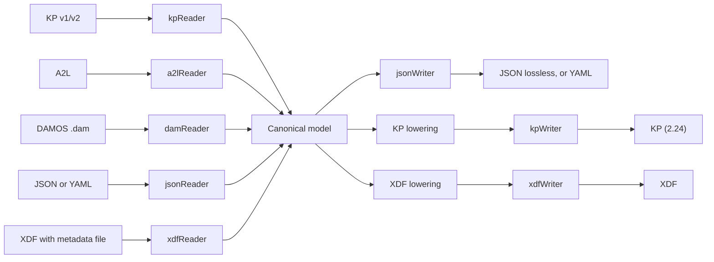

# Design: xdfkit, a map definition converter

Converts map definitions between WinOLS KP, A2L, DAMOS, TunerPro XDF and a canonical JSON/YAML model, and autocorrects KP files. Related docs: `model.md`, `format-matrix.md`, `kp-format.md`, `autocorrect.md`, `stamp-and-metadata.md`, `xdf-embedding.md`, `corpus.md`, `naming.md`, `integrations.md`.

## Formats

- Outputs:
  - Canonical JSON: the first-class dump of the shared model, defined by a JSON Schema (`model.md`). It holds no format-specific residue; KP output takes the KP-only fields from a template KP or from defaults.
  - YAML: an alternate encoding of the same model with the same schema. It is a syntax layer over the canonical JSON (converted node for node, numbers keep their spelling, so typed numbers and the stamp work the same), with no YAML-only features (anchors, tags, multiple documents).
  - KP in the WinOLS 2.24 format (MVP, unless the feasibility gate fails): the only known lossless way into WinOLS, and the only writer that can be tested end to end, by trial imports into 2.24.
  - XDF (TunerPro XML 1.50): lossy, always written with a metadata file (`name.meta.json`) holding what XDF can't express, so the pair is lossless; embedding it in a comment block is optional (`stamp-and-metadata.md`, `xdf-embedding.md`). Implemented in `xdf/` (`xdfkit -f xdf -i image`, `--tuner` for the subset in `model.md`) with `encoding/xml`, plus a reader that merges the metadata file back; the stamp line is not written yet. TunerPro facts behind the writer (confirmed in 5.00.10305 unless noted):
    - No XML declaration, ASCII only, non-ASCII as `&#xNNNN;`: TunerPro reads an undeclared XDF as Windows-1252 and garbles text under a UTF-8 declaration (characters outside Windows-1252 untested). It saves as XDF 1.80, ASCII, CRLF.
    - KP orientation is kept: TunerPro shows tables wider than 256 columns (MLHFM, 1 by 512). The KP axis "mirror" setting is not applied (no XDF equivalent known).
    - `author` only when the source has one; KP has none. TunerPro loads XDFs without it.
    - Targets TunerPro 5.00.9813 (2023) or later: older builds misload category numbers above 255 (8D0907551G has 323), and builds before 5.00.9503 crash on element text over 0x400 bytes in XDFs TunerPro didn't write. TunerPro 5.0.10305 crashes on load on any attribute value over 255 bytes (it copies each into a 256-byte buffer with `strcpy_s`); tests check every pack's XDF for it.
    - Matches mapdump's XDF, compared as parsed XML, on the 13 archived packs, except: no "Written" date comment, LF line ends in text, no units on axes the model lacks, empty text elements left out, empty elements written as start and end tags, a category repeated by name keeps its objects, float cells flagged 0x10000 (unconfirmed; no pack has float cells), conversion offsets below 0.5e-6 left out of the equation (junk such as -7.31383E-307 in some DAMOS exports is 325 characters in plain notation), `vislevel` on each table and constant (model level, or 2 when unmarked; mapdump wrote none), and linked axes: an image axis whose breakpoints are another curve (a 1D object at the axis address with as many cells, the same storage and the same conversion up to KP's rounding) gets `embedinfo type="3"` with that object's uniqueid and keeps its own `EMBEDDEDDATA`, which the reader uses. TunerPro 5.0.10305 shows the links and carries an edit made in either the map's axis or the linked curve to the other (8D0907551M, 06A906032HS). An XDF it saves (format 1.80) keeps the links and each axis's `EMBEDDEDDATA`, and reads back to the same model, exactly with the metadata file. Six-digit precision with mapdump's arithmetic, including its Java int shift that measures 32-bit unsigned cells at raw 0. Integer output type only when every value is a positive whole number: TunerPro's integer format shows 0 as a blank, so any other precision-0 value uses the header float format. A precision-0 label index of 0 is written as 0. An identity conversion's min and max are the unsigned raw span, on the cells and on image axes. TunerPro displays 8D0907551M and 8D0907558E (with "subtract" axis labels).
  - CSV map list (output only), in ecuxplot mapdump's format: one row per object in address order, value ranges read from the flash image, and a column per reference definition with the names of its maps whose id matches. It replaces mapdump (`mapcsv/`, `xdfkit -f csv -i image -r ref`). Differences from mapdump: axis columns follow the organisation (`kp-format.md`), objects without cells get "-" in the value columns, the raw range of 32-bit cells is masked to 32 bits instead of printed as 0x0, and float cells are read as floats.
  - Edit stamp: every JSON output (model and metadata file) and every XDF carries SHA-256 digests of its canonical text (RFC 8785 and `jq -S .`; for XDF, of the JSON view its elements parse to), so readers can tell whether the data was hand edited after xdfkit wrote it. See `stamp-and-metadata.md`.
- Inputs: KP v1 (header codes 0x71/0x74) and KP v2 (0x124/0x149), exactly as ecuxplot's mapdump reads them (`org.nyet.mappack.Parser` in [ecuxplot](https://github.com/nyetlabs/ecuxplot)); A2L; DAMOS `.dam`; canonical JSON or YAML; XDF, with its metadata file if there is one (implemented), or an embedded model block (not yet).
- Users are assumed to have no licensed WinOLS options. The route into WinOLS is KP (lossless for what the model and template carry; the format is undocumented). A2L/DAMOS/XDF into WinOLS goes through the model and the KP writer.
- Reader order: A2L (`a2l/`) before DAMOS (`dam/`). Both emit schema 1 objects with axes and conversions inlined and addresses lowered to file offsets (`model.md`). Shared-axis, conversion and record-layout lists, and `image` identity, are not read yet. A2L follows ASAM MCD-2 MC. DAMOS has no public spec; the reader uses the record layout and `/REP` order in `model.md` and warns where that does not cover a field.
- No A2L or DAMOS writers. In every WinOLS version checked (1.222 and 1.505 manuals, current product pages), DAMOS and A2L can only be imported, and only through the licensed Damos plugin (now OLS521, €785). The import is one-way, mostly limited to 1D/2D maps, and in EVC's words uses heuristics, so "the result isn't 100% safe".

## Implementation

- Separate repo, OS agnostic, command line first; other front ends (a standalone GUI app, other languages) go through the bindings below. Language: Go, pure (no cgo) for the core packages and the CLI, so the C library build is the only one that needs cgo.
- Bindings: the converter is a library first, so any language or UI framework can use it. Implemented so far: the `api` package with `convert`, `merge`, `verify`, `lint`, `fix` and `version`, and the CLI on top of it. Not yet: `rpc`, the C ABI library and WebAssembly.
  - Core packages work on bytes, never paths: no file or console I/O, no `os.Exit`, no mutable globals, safe for concurrent calls. `kp` and `canon` already follow this.
  - One façade package (`api/`) is the only surface the bindings use: named methods such as convert, merge, lint, fix and verify, each taking input bytes plus a JSON request and returning output bytes plus a JSON response (findings, loss report, warnings) or a JSON error. Structured data crosses every boundary as canonical JSON, so a binding needs no per-type code. It recovers every panic into an error, so a bug never takes down a host process. Built now, ahead of new features, and the CLI is a client of it. The request and response fields are the godoc (`go doc go.nyet.org/xdfkit/api`).
  - Surfaces over the façade: the CLI; a sidecar mode (`xdfkit rpc`, one JSON request and response per line on stdin/stdout) for front ends that run the binary; a C ABI shared library (`.dll`, `.so`, `.dylib` plus a header, built with `-buildmode=c-shared` from `capi/`, the only cgo code); and WebAssembly.
  - In `rpc` mode a file argument is either a path or base64 in the JSON; the C ABI and WebAssembly always pass bytes.
  - C ABI: one generic call, `xdfkit_call(method, request JSON, input bytes)`, returning output bytes and response JSON, plus a free function and an ABI version call. New methods never change the ABI. UTF-8 strings and byte buffers with explicit lengths; output allocated by the library and released with its free function; no Go pointers kept by the caller and no callbacks; the JSON documents carry their schema version.
  - The project ships the C header and the shared libraries only. Language wrappers (.NET P/Invoke, Python ctypes or cffi, Java JNA or the FFM API) live with the apps that use them.
  - Known limits of Go shared libraries: each library carries its own Go runtime (several MB), loading two Go-built shared libraries into one process is unreliable, and building for each OS needs that OS's C toolchain (native CI runners).
- Licence: LGPL-3.0-or-later for the whole repo (`COPYING.LESSER`, with the GPL text it builds on in `COPYING`), so any program may link the shared library while changes to xdfkit itself stay copyleft. `kp/` is ported from ecuxplot's GPL-3.0 `org.nyet.mappack`, whose author relicenses the port.
- CLI naming: conversions are named `XXX2YYY` (input format, `2`, output format), for example `kp2json`, `json2kp`, `xdf2kp`. One binary serves them all: `xdfkit kp2json FILE...` works on every platform, and the binary also dispatches on its own name (ignoring a `.exe` suffix), so a link named `kp2json` behaves like `xdfkit kp2json`. Each FILE becomes the same name with the output extension, next to it; an existing file is never replaced, XDF output writes its metadata file only with `-m`, and XDF input reads `NAME.meta.json` beside it. XDF output takes the flash image with `-i`. Options follow CLI options below. `make build` links them in `build/`; the Unix release archives hold the symlinks, and the Windows zip ships one-line `.cmd` shims (`@"%~dp0xdfkit.exe" kp2json %*`) instead, since Windows symlinks need extra privileges and zip files can't hold links. An `XXX2YYY` command rejects input that isn't format `XXX`. The plain form (`xdfkit [-f FMT] input [output]`, input format detected from the contents) stays. The commands are `xdf2kp`, `kp2xdf`, `kp2json`, `xdf2json` and `json2kp` (`cmd/xdfkit/alias.go`, list in `ALIASES` in the Makefile; `make check-links` runs the links); other pairs are not implemented yet. A command takes only its own options, and its help covers only them. A link by another `XXX2YYY` name is refused with the list of commands instead of running as plain `xdfkit`. On Unix, `xdfkit install-links DIR` creates the symlinks (not implemented yet).
- CLI options: a single hyphen introduces single-letter options only (`-f xdf`, `-fxdf`, `-mi image`); long options take two hyphens (`--force`, `--template`, `--format`). A long option spelled with one hyphen (`-force`) is an error that names the two-hyphen spelling. Every single-letter option also has a long name; options may come before or after the files. The CLI parses options with `github.com/spf13/pflag`. Flags given to `go test` (`-run`, `-update`) follow `go test`'s convention.
- Project name: `xdfkit` (Go module `go.nyet.org/xdfkit`, repo `github.com/nyetlabs/xdfkit`).
- The WinOLS binaries are packed (VMProtect and repacked sections), and unpacking means defeating the copy protection, which this project won't do. KP decoding therefore relies on feature-sweep samples (KP files saved by WinOLS with one property changed at a time) plus the UI strings in `OLS_LangE.dll`, which is readable as shipped.
- KP v2 compression: the `intern` entry is raw deflate that zlib 1.2.x at level 9 reproduces exactly (see `kp-format.md`). Go's `compress/flate` produces a different, still valid, stream. xdfkit uses pure Go and judges the stage-1 round trip on the inflated block; WinOLS 2.24 opens re-deflated files (once `EndOffset` is updated; `kp-format.md`).

## Merge

`xdfkit merge` folds a second definition into a base pack. Inputs are KP, XDF (with its `.meta.json`), JSON or YAML, read through the existing readers. Provenance stays the base file's. `--force` only replaces an existing output file. Replacing a matched map is `--overwrite`. `-n` prints the report and writes nothing. One file with `--smart` only folds that file. The request fields are `go doc go.nyet.org/xdfkit/api MergeRequest`.

```
xdfkit merge [--smart] [--update] [--overwrite] [-n]
             [--description keep|fill|replace] [--comment keep|append|replace]
             [-f json|yaml|kp|xdf] [-i image] [--meta file] [--force]
             base [incoming] [output]
```

A name match uses `key` when it is set, otherwise `id`, as the whole string. A blank key and a blank id match nothing. `-` is a real id. The base key and id stay. A name match consumes the incoming object: text is applied, and the object is not also appended when the address differs. A repeated name is ambiguous for layout (`--update` does not copy it). When every incoming object with that name has the same description and comment, that text is applied to every base object with the name.

A span match is the same address, rows, cols and cell bits. The same raw layout also means the same cell signed, endian and float, the same object inverse, and the same image-axis address, bits and stored. An overlap that is not an equal span is kept as two objects (`overlap`).

`--update` copies only what a locator detects: address, shape, rows, cols, cell bits and signed, and each image axis's source, address and bits. It leaves the base conversion, precision, units, view, min/max, endian, float, axis stored and axis signed, and reports `default` where the incoming value differs. Empty incoming units do not clear the base. Non-empty units that differ are `units`, and the base units stay. A factor of 1 is not written onto the base. A new axis copies only its source, address and bits. An existing map keeps its categories; a difference is reported. `--overwrite` replaces the whole object except the base key and id. `--description` and `--comment` override the mode default and do not copy layout. With neither `--update` nor `--overwrite`, description and comment stay (`keep`). `--update` fills an empty description and appends comment lines that are not already there. `--overwrite` replaces both when the incoming text is non-empty.

`--smart` folds each file by span before the name pass. The same units, conversion, precision and axis display with different categories become one object whose categories are the union. A different display at the same raw layout becomes an alternate (`model.md`). Signed versus unsigned, a different width, or a different axis address or length stays two objects.

New names are appended after the base objects, and each generator default on a new map is reported `default`. A base name missing from the incoming file is kept and reported `missing`. The report actions are `added`, `kept`, `corrected`, `description`, `comment`, `units`, `default`, `missing`, `ambiguous`, `overlap`, `categories`, `alternate`, `overwritten` and `skipped`.

XDF output writes one table per category and per alternate (`stamp-and-metadata.md`). KP output writes the first category only, and says so.

## Architecture



- `model`: specified in `model.md`. Schema 1 inlines each object's axes and conversion. A record holds id, description, comment, categories, address (a file offset), element type/width/sign/endianness, shape (value, 1D, 2D), conversion (factor, offset, reciprocal), units, precision, display base, limits, difference and percent flags, and axes. Shared-axis, conversion and record-layout lists, the original CPU address, bit masks, formulas and enum tables are not in schema 1.
- No per-source residue in the model: the KP writer takes what the model doesn't carry from a template KP, by default an empty WinOLS map pack plus generated per-field defaults (`model.md`, KP output). As fields get identified, they become model fields.
- `json` reader/writer: the JSON Schema is generated from the model types, committed as `model/schema.json`, and validated in tests. Output is the canonical `jq -S .` form (sorted keys, 2-space indent; see `stamp-and-metadata.md`), so diffs stay readable. YAML is converted node for node to and from that JSON (`canon/yaml.go`), so it goes through the same typed reader and stamp.
- Address lowering is inside `a2l/` and `dam/` (`model.md`). A2L uses a `MEMORY_SEGMENT` that contains the address, otherwise the ME7 window at 0x800000. DAMOS subtracts 0x800000 in that window. A separate `addrmap/` package, a `--base` override, and keeping the original CPU address are not implemented.
- Each writer has a lowering pass that reports, per object, what it dropped or approximated. The loss report goes to stderr, or to a file with `--report`.

## Repo layout

- `cmd/xdfkit/` CLI: `xdfkit [-i image.bin] [-f json|yaml|kp|csv|xdf] input [out]` (planned: `--base 0x...`, `--report f`), with input format detected from the file contents (a leading `{` is JSON, a leading `<` is XDF, the KP signature is KP, `ASAP2_VERSION` is A2L, an ASAP2DAM banner is DAMOS, anything else is YAML; output format from `-f`, else the output extension, `.yml` meaning YAML); `XXX2YYY` conversion commands (see Implementation, CLI naming); subcommands `xdfkit lint` and `xdfkit fix` (see Autocorrect) and `xdfkit merge` (below)
- `api/`: the façade (typed `Convert`, `Merge`, `Verify`, `Lint`, `Fix`, `Version`, and the generic `Call(method, request, input)` that returns canonical JSON responses or `{"error": ...}` and recovers panics). The version string lives here (`api.Version`, set by the Makefile). `Call` method `merge` takes the base definition as its input.
- `internal/testenv`: test inputs (ecuxplot data, jq; skip, or fail with `XDFKIT_REQUIRE_DATA`).
- `internal/corpus`: test access to `ecu-corpus`, from `../ecu-corpus` or the submodule (manifest lookups by name or SHA-256, skip or fail when absent).
- `model/`: the canonical model, its KP conversion, and the schema generator with the committed `schema.json`.
- `kp/` (KP reader and writer), `lint/` (autocorrect), `mapcsv/` (CSV map list), `xdf/` (XDF writer, reader and metadata file), `a2l/` (A2L reader), `dam/` (DAMOS reader).
- Planned: `capi/` (C ABI shared library, cgo), `addrmap/`, `cmd/sampdiff/`
- `Makefile` (lint, test, build, package; version from git tags), `.github/` (build and release workflows, Dependabot), `cliff.toml` (release notes).
- `docs/`, `testdata/` (committed fixtures, including `testdata/a2l/` and `testdata/damos/`), `testdata/local/` (gitignored; tests do not read it), `ecu-corpus/` (the `ecu-corpus` git submodule, see `corpus.md`)

## Verification

- KP to XDF matches `mapdump -x -i bin`, compared as parsed XML, for every archived ecuxplot KP and its image, except the deliberate differences above (`go test ./xdf` with `XDFKIT_MAPDUMP_DIR` set to mapdump's output).
- KP to JSON to KP: byte-identical for v1; identical inflated block and container fields for v2 (the stage 1 gate).
- Round trip: for every test input, input to JSON to model to JSON is identical, and JSON to YAML to JSON is identical. So is input to XDF (with embedded block) to model to JSON, including test strings containing `--`, `-->`, `<!--`, `]]>`, a trailing `-`, and non-ASCII. Notes are excluded from the comparison.
- XDF plus metadata file to JSON equals the source JSON for every test input, with and without the image. Editing a table in the XDF makes the reader warn that the XDF is edited and reconcile each object with its metadata (`go test ./xdf ./api`).
- Stamps: every output verifies clean under both digests; `jq -S 'del(.stamp)' f.json | shasum -a 256` equals the `jq -S .` digest and the RFC 8785 transform of `jq -c 'del(.stamp)'` hashes to the `RFC8785` one; changing any value flags `edited`; reindenting or reordering object keys doesn't; respelling a number flags `mixed`.
- Feature-sweep samples: each variant's JSON differs from the base sample only in the field that was changed.
- WinOLS 2.24 (checked by hand in the GUI): synthesized KP imports cleanly, by trial and error until it does. XDF checked in TunerPro.
- A2L reader: checked against the ASAM spec and real A2L files with known values, not against WinOLS.
- DAMOS reader: on 06A906032S, names, file offsets, storage, axis addresses and shape agree with the corpus definition converted from that DAMOS (shared axes, which that definition left as single values, take their length and address from the axis-point table). The model round-trips through KP and XDF.
