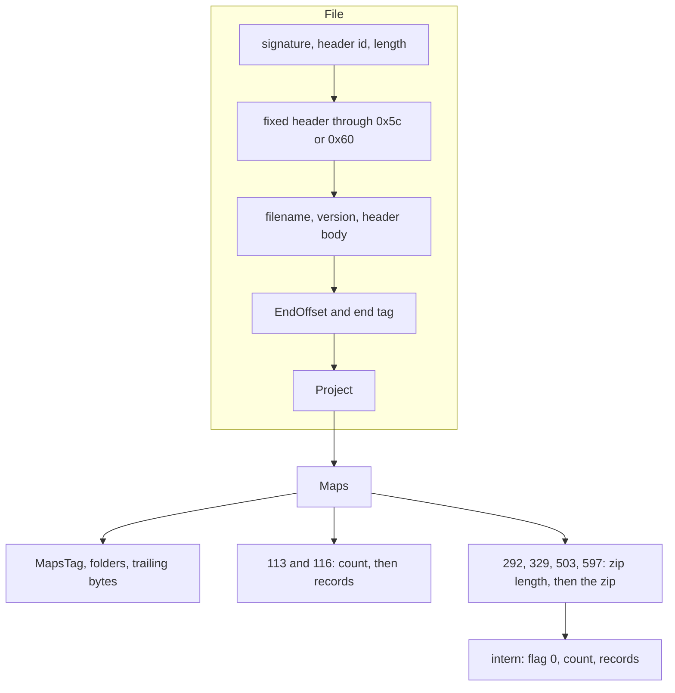

# KP format

WinOLS map pack (`*.kp`), read and written by `kp/`. Integers are little-endian. A string is an int32 byte count, that many ISO-8859-15 bytes, and a NUL. A zero count has no NUL.

The Go structs are the record layouts. `kp/codec.go` walks fields in declaration order; the tag grammar is at the top of that file. JSON names are those fields with a lower-case first letter. `kp-defaults.json` uses the JSON names (`model.md`). File, Project and Folder always use that walk. On 503 and 597, Map and Axis leave it for a hand walk in `kp/ols5.go` (`codeOLS5`): float ranges, name padding, ID/Range pads, string modes and a two-byte `Term2` differ from the 113/116 and 292/329 tags, so Map/Axis `kp` tags are not the source of truth for 503 and 597. Shared primitives (`strRaw`, `mirrorI32`, `hexBytes`) serve both paths.

## Versions

The int32 at offset 0x10 is a decimal header id. Headers that share a row share a record walk, named by hundred: 100 (113 and 116), 200+300 (292 and 329), and 500 (503 and 597). The Go constants and `kp` tags are still v1, v2, and ols5.

| Header | Walk | Value at 0x14 | Fixed header ends | Maps |
| --- | --- | --- | --- | --- |
| 113, 116 | 100 | 0 | 0x5c | inline |
| 292, 329 | 200+300 | file length | 0x60 | zip entry `intern` |
| 503, 597 | 500 | file length | 0x60 | zip entry `intern` |

329 is accepted. The archived packs use 292. WinOLS 2.24 writes header 292 and version string `OLS 5.0 (Windows)`. The filename string is the name the file was exported under, usually upper case.

503 and 597 use one walk and differ in a few sizes. They are read-only: `Encode` returns an error until a save oracle exists. Name and version trailers are 84 bytes on 503 and 93 on 597. A marked map's extra block is 65 bytes on 503 and 69 on 597, and the stub after the maps matches that size. Outer filename and version strings have no trailing NUL. Map and value/axis unit strings use the raw (no trailing NUL) form; the map name is length-prefixed with a NUL and three pad bytes when non-empty, or four pad bytes when empty. Map value ranges are six `float64`s in the file and are stored in the existing `[3][2]int64` slots (values seen so far are whole). Empty map-block strings use a negative length and no NUL (`-1`, and `-3` on header 503). Folder `Pad` is 36 bytes. `EndTag` is 8 bytes (`99 78 00 42 02 00 00 00`). Axis `Values` are a byte length that is a multiple of 4. KP-only residue defaults in `kp-defaults.json` are pooled by hundred: `"100"` (113 and 116), `"200+300"` (292 and 329), and `"500"` (503 and 597; from a local 597 pack when regenerating). `"default"` holds values shared by at least two pools; each pool lists only what differs, and null drops a shared field.

Every archived pack ends with `33 88 72 98`. `EndOffset` is the offset of that marker (file length minus 4). WinOLS imports a file whose length changed without updating `EndOffset`, and raises its crash-report dialog.

## Layout



The bytes from 0x18 to the end of the fixed header are zeros (`FixedHeader`). The header between the version string and `EndOffset` is `HeaderBody`. Both, and `Project.Trailing`, are kept raw. They change between saves and are not map data. The header walk is `kp.walkHeader`. On 503 and 597 the body stays opaque except for locating the end-tag magic.

After `EndOffset`:

- `EndTag`, 12 bytes on 113, 116, 292, and 329: `00 00 00 00 99 78 00 42 02 00 00 00`; 8 bytes on 503 and 597: `99 78 00 42 02 00 00 00`
- Project name, int32[4] `NameTag` and `NamePad` (4 zeros) on 292 and 329; a name trailer on 503 and 597 (84 bytes on 503, 93 on 597)
- Project version, int32[4] `VersionTag` (equal to `NameTag`) and `VersionPad` on 292 and 329; a version trailer on 503 and 597, same sizes as the name trailer
- int32 `Build`, and `BuildFlag` (1) on 292, 329, 503, and 597

`NameTag`, `VersionTag`, `Build`, and `MapsTag` are the same in every archived pack and in WinOLS 2.24 exports, including an empty project.

Maps, then int32[3] `MapsTag`, then the folder table:

- 113 and 116: int32 count, then the map records
- 292, 329, 503, and 597: int32 zip length, then the zip. The folder table follows the zip. The inflated `intern` entry is one byte 0 (`InternFlag`), an int32 count, then the map records

Each folder is int32 id, int32 `BuiltIn`, name, 2 bytes `Flags` (`01 01`), int32 `Style` (`0x1000000`), and 15 zero bytes `Pad` on 292 and 329 (36 bytes on 503 and 597). `BuiltIn` is 9000 on My maps, 9001 on Hexdump, and 0 on every other folder. mapdump sorts folders by name, drops duplicate names, and renumbers folder ids. This reader keeps the table as stored.

## Round trip

`Parse` and `Encode` share one walk, so every byte is a field or a raw block. Encode writes the length at 0x14 and `EndOffset` back into the `File` for headers 292 and 329. Encode of 503 and 597 is not supported yet.

- 113 and 116: parse then encode is byte-identical, including JSON in between
- 292 and 329: the original zip is reused while the map block is unchanged. A changed block is re-deflated with Go `compress/flate` at level 9. The inflated block, and the file outside the zip, match aside from the two lengths

Decoding fails when a bool is not 0 or 1, a string has no NUL, a free-editable list length is not a multiple of 4, or bytes remain after the maps on 292 and 329.

## Zip on 292, 329, 503, and 597

One local entry, name `intern`, method 8, general-purpose flag 2, DOS date and time zero, version 20. The archived streams match zlib 1.2.x raw deflate at level 9, memLevel 8, window 15. WinOLS 2.24 links zlib 1.2.3. Go's deflate differs, so a rewritten file must update the zip length, the length at 0x14, and `EndOffset`. WinOLS 2.24 imports those files.

## Map

Order is the `kp.Map` struct. Fields that only 292 and 329 carry are marked.

| Field | Type | |
| --- | --- | --- |
| `Marked` | byte | 0 or 1. WinOLS map-list marker (Insert/delete marker; filter Only marked / Only unmarked). Confirmed on TLDOBAN-50a / 51-marker / 52-unmarker. Model `vislevel` 1 when set, else 0 |
| `LinkID` | int32, v2 | |
| `Comment` | string, v2 | |
| `CommentFlag` | byte, v2 | |
| `Name` | string | long description |
| `Organization` | int32 | [Enums](#enums) |
| `RightPane` | int32 | HelpEn `RWin` candidate (0 none, 1 hex, 2 bars, 3 both). The hexdump's right pane does not write this field. Unconfirmed in the map window |
| `Type` | int32 | element type; [Enums](#enums) |
| `Width` | int32 | element size in bytes; matches `Type` |
| `Base` | int32 | 10, 16, or 2 |
| `FolderID` | int32 | |
| `ID` | string | short name. mapdump drops anything after a space or `?` |
| `IDPad` | int32 | 0 |
| `IDFlag` | byte | 0 |
| `IDState` | int32, v2 | 0 or 1. Meaning unconfirmed; often constant per pack. Residue only (not in the model). Was wrongly named Marked before the map-list marker was confirmed |
| `Range` | int64[3][2] | [below](#range) |
| `Reciprocal`, `Signed`, `Difference`, `Percent` | byte | 0 or 1, in that order. `Difference` and `Percent` are the map-window toggles (model `view`) |
| `Cols`, `Rows` | int32 | |
| `Cursor` | int32[2] | changes when the map is opened |
| `Precision` | int32 | |
| `Value` | | description, units, float64 factor, float64 offset |
| `Start`, `End` | int32 | [below](#addresses) |
| `ImageSize` | int32 | image length |
| `ImageSizePad` | int32[2], v2 | 0 |
| `Addr2` | int32 | [below](#addresses) |
| `Addr2Flags` | int32[2] | |
| `Addr2ImageSize` | int32 | image length, or 0 |
| `Addr2Pad` | int32 | 0 |
| `X`, `Y` | axis | [Axis](#axis) |

The hexdump's original-value toggle does not change a decoded field.

### Range

Three low/high pairs, in order: 8-bit, 16-bit, 32-bit. WinOLS writes the pair for the map's width, as typed in Value range (raw / eprom units, not factor-scaled). Toggling the map display between raw and scaled does not change the dialog numbers. An 8-bit map uses the first pair (TLDOBAN, 10 to 90). A 16-bit map uses the second (NMAX, 1000 to 6000; KFMIOP, 10 to 90). A 32-bit map uses the third (NMAX-30-range32, 1000 to 9000). Defaults are 0 and 255, 0 and 65535, 0 and 4294967295. A negative low is sign-extended.

The field cannot be omitted. Without a template, the pair for the map's width is the model's min and max converted from display units to raw (ordered low to high). Otherwise it is the default raw pair for the width. The other two pairs stay at the defaults. The model omits min and max when the KP pair is that default.

### Addresses

`End` is `Start` plus the map's byte length, one past the last byte. WinOLS recomputes a stale end on export. `xdfkit fix` rule R8 does the same (`autocorrect.md`).

`ImageSize` is the image length: `0x100000` in most archived packs, `0x20000` in 8D0907558E, `0x40000` in 8D0907558M.

Moving a map or duplicating it sets `Addr2` to the new start.

### Storage order

`StoredCols` then `StoredRows` follow `Cols` and `Rows`, swapped on organisation 5 (2D inverse). xdfkit reads the cells row-major and writes the swapped pair for organisation 5.

### Tail

The 80 bytes after the Y axis:

| Offset | Field | Type | |
| --- | --- | --- | --- |
| 0x00 | `YFlag` | int32 | |
| 0x04 | `YPad` | int16 | 0 |
| 0x06 | `StoredCols` | int32 | [Storage order](#storage-order) |
| 0x0A | `StoredRows` | int32 | |
| 0x0E | `ViewMode` | int32 | 1 text, 2 2D, 3 3D |
| 0x12 | `ViewFlags` | byte[2] | |
| 0x14 | `View2DScale` | float64[2] | |
| 0x24 | `View2DRef` | int32 | |
| 0x28 | `ViewFlag` | byte | |
| 0x29 | `View3DRotation` | float64[2] | |
| 0x39 | `ViewScale` | float64 | |
| 0x41 | `ViewScaleRef` | int32 | |
| 0x45 | `ViewOffset` | float64 | |
| 0x4D | `Term2` | byte[3] | 1, 1, 1. The first two must be 1 |

Opening a map in WinOLS can change `Cursor`, `Marked`, and `ViewScale`.

## Axis

Both records are stored on every map. WinOLS uses X for a 1D map, X and Y for a 2D map, and neither for a single value.

| Field | Type | |
| --- | --- | --- |
| `Value` | | description, units, factor, offset |
| `DataSource` | int32 | [Enums](#enums). Address matters for image sources |
| `Addr` | int32 | |
| `Type`, `Width`, `Base` | int32 | `Width` is the element size in bytes |
| `Mirror` | int32 on 292 and 329, byte on 113 and 116 | 0 or 1. [below](#mirror) |
| `MirrorPad` | 9 bytes on 292 and 329 | zeros |
| `Reciprocal` | byte | |
| `Precision` | int32 | |
| `Signed` | byte | |
| `Values` | length, then bytes | [below](#free-editable) |
| `DataHeader` | int32 | [below](#data-header-and-signature) |
| `SignatureByte` | int32 | [below](#data-header-and-signature) |

### Data header and signature

`DataHeader` is HelpEn's `DataHeader`: how many bytes before the axis data WinOLS treats as a header (0, 1, 2, or 4). Non-zero headers commonly hold the point count (one byte, or two for a word count). A 4-byte header on a word axis of a 2D map is often two little-endian uint16 counts, this axis then the other. Many image axes keep the field at 0 even when those bytes exist in the image, so it is a setting, not a discovery from the flash. Model `header`.

`SignatureByte` is HelpEn's `SignaturByte`. `-1` means none (the usual value). Otherwise it often matches the byte two before the axis (a variable id on M3 packs). Model `signature`, omitted for `-1`.

### Mirror

WinOLS "&Mirror map". The image stays in stored order. WinOLS shows the axis, and the cells along it, from the high end. mapdump treats the flag as undefined and drops that axis's units and scale, so its CSV differs in those columns.

### Free editable

Datasource 4. `Values` is length-prefixed; the length is always 4 bytes times the axis point count. The points are packed consecutively in the axis element type (little-endian for multi-byte), then zero-padded to that length. An 8-bit axis with values 1..8 is 32 bytes (`01`..`08`, then zeros). A 16-bit axis (KFMIOP-06 X) packs `u16` LE values the same way and pads to 4×points. Free editable also clears the axis address and sets its factor to 1. Switching away from free editable (including to EEPROM backwards) leaves `Values` empty.

On 292 and 329 the list is empty except on free-editable axes. On 113 and 116 both axis records hold zeros, 4 bytes per stored row, on almost every map.

## Enums

| Field | Values |
| --- | --- |
| Organisation | 2 single, 3 1D, 4 2D, 5 2D inverse |
| Value type | 1 8-bit, 2 16-bit HiLo, 3 16-bit LoHi, 4 32-bit HiLo, 5 32-bit LoHi, 6 float HiLo, 7 float LoHi |
| Data source | 0 ordinal, 1 EEPROM, 2 EEPROM add, 3 EEPROM subtract, 4 free editable, 5 EEPROM backwards |
| Display base | 10, 16, 2. An omitted base is written as 10. WinOLS crashes when a map whose base is 0 is opened. |

Datasource 4 and 5 are free editable then EEPROM backwards. The WinOLS UI lists those two in the other order.

## EEPROM, add

Datasource 2 stores successive gaps from the start. Displayed point i is

```text
conversion(raw[0] + raw[1] + ... + raw[i])
```

with no wrap. TLDOBAN X (save `TLDOBAN-23-add.kp`), raw 25, 38, 50, 63, 75, 100, 125, 150, factor 40, displays 1000, 2520, 4520, 7040, 10040, 14040, 19040, 25040.

## EEPROM, subtract

Datasource 3 stores the gaps between axis points, counted down from the top of the range. For an 8-bit axis, displayed point i is

```text
conversion(256 - (raw[i] + raw[i+1] + ... + raw[n-1]))
```

with no wrap. The last raw value is the gap from the last point to 256.

FHSA.0 X in 8D0907558E, raw 27, 13, 12, 60, factor 0.75, offset -48, displays 60, 80.25, 90, 99.

The label in a pack can be wrong either way. KFFA X in 8D0907558E is a subtract axis labelled EEPROM (1.0, 1.6, 2.2, ..., 11.0 ms/rev once relabelled). KFWKSTAB X in 8D0907551M is an absolute axis labelled subtract. Rules R1 and R2 relabel these (`autocorrect.md`).

On M3 images the two bytes before one of these axes are the variable id and the point count.

## EEPROM, backwards

Datasource 5 shows the absolute image values in reverse order. Displayed point i is

```text
conversion(raw[n - 1 - i])
```

Address and factor stay as for EEPROM. Mirror is a separate flag and stays off. TLDOBAN X (save `TLDOBAN-24-backwards-display.kp`), raw 25…150, factor 40, displays 6000, 5000, 4000, 3000, 2520, 2000, 1520, 1000.

The model keeps `axis.stored` as written (`absolute`, `add`, `subtract`, or `backwards`).

The XDF writer emits a live helper table for an unsigned 8, 16 or 32-bit add or subtract axis that is not reciprocal. The helper is a 1-column table at the axis address, linked from the map axis with `embedinfo type="3"`. For subtract, the last row is `(2^bits - X) * factor + offset` and each earlier row is `CELL(ROW()+1;0;FALSE) - factor * X` (factor before `X`, as in `0.75 * X`). For add, the first row is `factor * X + offset` and each later row is `CELL(ROW()-1;0;FALSE) + factor * X`. Rows are numbered from 1. TunerPro 6.00.0149.00 shows FHSA.0 X (subtract) that way: raw 27, 13, 12, 60 reads as 60, 80.25, 90, 99. Builds before 5.00.8414 (2014) miscompute the subtract pattern. `--static-axes` writes static labels from the image instead; without an image those axes are plain image axes. A signed, float or reciprocal add/subtract axis uses the labels when an image is present, otherwise a plain image axis. Backwards has no live helper (XDF cannot reverse the embedded order): with an image the writer emits static labels; without one, a plain image axis (forward order). The reader leaves helpers out of the model. The metadata file keeps the axis.

## WinOLS 2.24 exports

Compared with an imported pack:

- Header id 292 and version `OLS 5.0 (Windows)`, as [above](#versions)
- `End` rewritten to start plus byte length where the pack had a stale end
- `Cursor`, `Marked`, and `ViewScale` changed on maps opened in the session
- The `intern` stream matches zlib level 9, memLevel 8, as in the archived packs
