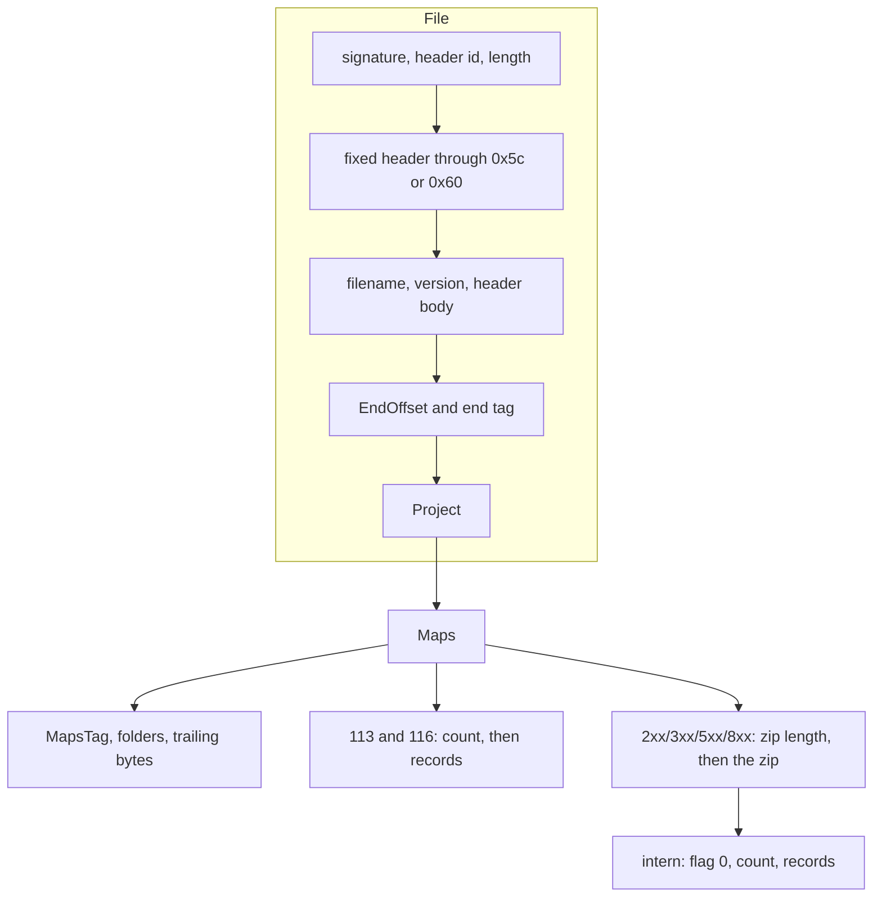

# KP format

WinOLS map pack (`*.kp`), read and written by `kp/`. Integers are little-endian. A string is an int32 byte count, that many ISO-8859-15 bytes, and a NUL. A zero count has no NUL.

The Go structs are the record layouts. `kp/codec.go` walks fields in declaration order (tag grammar at the top of that file). JSON names are those fields with a lower-case first letter (`kp-defaults.json`, `model.md`). File, Project and Folder always use that walk. 5xx and 8xx use a hand walk for Map and Axis (`kp/ols5.go`); their `kp` tags are not the source of truth for those series.

## Versions

The int32 at offset 0x10 is a decimal header id. Routing keys off the hundred series (`id/100`); hex/BCD does not show a clear major/minor/patch split. Known samples: 113/116 (1xx), 245 (2xx hybrid), 292/329 (2xx/3xx), 503/597 (5xx), 839 (8xx). Walk names match `kp-defaults.json` pools.

| Series (samples) | Walk | Value at 0x14 | Fixed header ends | Maps |
| --- | --- | --- | --- | --- |
| 1xx (113, 116) | 100 | 0 | 0x5c | inline |
| 2xx hybrid (245) | 200+300 | 0 | 0x5c | zip entry `intern` |
| 2xx/3xx (292, 329) | 200+300 | file length | 0x60 | zip entry `intern` |
| 5xx (503, 597) | 500 | file length | 0x60 | zip entry `intern` |
| 8xx (839) | 800 | file length | 0x60 | zip entry `intern` |

329 is accepted; archived packs use 292. WinOLS 2.24 writes header 292 and version `OLS 5.0 (Windows)`. A V2 hybrid is any 2xx/3xx with `HeaderLen` 0 (sample 245; unconfirmed mid skip): V1-sized fixed header, V2 project/zip, V1 map walk plus `IDState`, axis `Backwards` as int32 plus a 1-byte pad (no LinkID/Comment/ImageSizePad), folder pad 14, header-body mid without term2a/`"Binary data"`. Hybrids, 5xx, and 8xx are read-only. Within 5xx, trailer and MarkedExtra lengths follow the tens band (`id/10`): 50x (sample 503) is shorter than other 5xx (sample 597); 8xx scans MarkedExtra. OLS5 string modes: `kp/ols5.go`.

8xx (unconfirmed details in `kp/ols5.go`, `kp/header8xx.go`): name trailer 105 and version trailer 109; EndTag found by a `… 02 00 00 00` plus printable project name (first four EndTag bytes vary); eight bytes between the zip and MapsTag; folder entries with a length-prefixed blob; each axis ends with a 20-byte TailPad (`0,0,-1,0,0`); MarkedExtra is usually 73 bytes, with long comments after the block before the display name. WinOLS CSV on the local 839 pair matches IdName/StartAddr and, with value variance, map `RWin`, `ViewMode`, and `Signed` (`bSigned`). CSV `Marker` does not match KP `Marked` on that export. `bDelta` / `bPercent` are all zero there, so which KP bool is which stays open.

CI parse smoke uses minimal complete packs under `testdata/kp/` (one few-map fixture per header family: 116, 292, 245, 503, 597). Full private saves stay in `testdata/local/`; the frozen ecuxplot archive is separate and not for new fixtures.

Every archived pack ends with `33 88 72 98`. `EndOffset` is that marker's offset (file length minus 4). KP-only residue defaults in `kp-defaults.json` are pooled by hundred (`"100"`, `"200+300"`, `"500"`, `"800"`); `"default"` holds values shared by at least two pools.

## Layout

`FixedHeader` (0x18 through the fixed end) and `HeaderBody` (version string through `EndOffset`), plus `Project.Trailing`, are kept raw. After `EndOffset`: end tag, project name/version (and trailers on 5xx/8xx), then `Build`. Field sizes and tag constants: `kp/` structs.

Maps, then `MapsTag`, then folders:

- 1xx: int32 count, then map records
- 2xx/3xx/5xx/8xx: int32 zip length, then the zip; folders follow. Inflated `intern` is flag 0, count, records

Each folder: id, `BuiltIn` (9000 My maps, 9001 Hexdump, else 0), name, flags, style, pad. This reader keeps the table as stored.

## Round trip

`Parse` and `Encode` share one walk. Encode writes the length at 0x14 and `EndOffset` for non-hybrid 2xx/3xx. Encode of V2 hybrids, 5xx, and 8xx is not supported.

- 1xx: parse then encode is byte-identical (including the KP file's own JSON in between). A KP written from the model carries cleaned display text (`model.md`), so those bytes match when that text was already clean.
- non-hybrid 2xx/3xx: original zip reused while the map block is unchanged; a changed block is re-deflated with Go `compress/flate` level 9. Inflated block and bytes outside the zip match aside from the two lengths

Decoding fails when a bool is not 0 or 1, a string has no NUL, a free-editable list length is not a multiple of 4, or bytes remain after the maps on non-hybrid 2xx/3xx.

## Zip on 292+

One local entry, name `intern`, method 8. Archived streams match zlib 1.2.x raw deflate at level 9. Go's deflate differs, so a rewritten file must update the zip length, the length at 0x14, and `EndOffset`.

## Map

Order is the `kp.Map` struct. Writers need:

- `Marked` → model `vislevel` 1 when set, else 0
- `Type` (HelpEn Type/Typ), `DataOrg` / `Width`, `Radix` (10/16/2): [Enums](#enums)
- `ID` (short name), `Name` (long description), optional `Comment` (v2)
- `Range`: three low/high pairs for 8/16/32-bit raw spans. Without a template, the pair for the map's width is the model's min/max converted to raw; the other pairs stay at defaults. The model omits min/max when the KP pair is that default.
- Flags: `Reciprocal`, `Signed` (HelpEn `bSigned`), `Difference` / `Percent` (HelpEn `bDelta` / `bPercent` candidates)
- `RWin`, `ViewMode` (1 text, 2 2D, 3 3D)
- `Cols`, `Rows`, `Precision`, `Value` (description, units, factor, offset)
- `Start`, `End` (`End` = start + byte length; MP01 in `autocorrect.md`), `ImageSize`, `Addr2`
- Axes `X`, `Y`: [Axis](#axis)
- `StoredCols` / `StoredRows` follow `Cols`/`Rows`, swapped on Type 5 (2D inverse)
- Other view-state after Y is residue; see `kp.Map`

## Axis

Both records are stored on every map. WinOLS uses X for 1D, X and Y for 2D, neither for a single value.

| Field | Notes |
| --- | --- |
| `Value` | description, units, factor, offset |
| `DataSource` | HelpEn DataSrc; [Enums](#enums). Address matters for image sources |
| `Addr`, `DataOrg`, `Width`, `Radix` | `Width` is element size in bytes |
| `Backwards` | HelpEn bRueckwaerts / bBackwards: image stays stored order; WinOLS shows high end first |
| `Reciprocal`, `Precision`, `Signed` | |
| `Values` | free-editable list: length is 4× point count; points packed in element DataOrg, zero-padded |
| `DataHeader` | bytes before axis data treated as header (0/1/2/4); model `header` |
| `SignatureByte` | `-1` means none; model `signature`, omitted for `-1` |

On 292/329, `Values` is empty except on free-editable axes. Free editable (datasource 4) clears the axis address and sets factor to 1.

## Enums

| Field | Values |
| --- | --- |
| Type (Typ) | 2 single, 3 1D, 4 2D, 5 2D inverse |
| DataOrg | 1 8-bit, 2 16-bit HiLo, 3 16-bit LoHi, 4 32-bit HiLo, 5 32-bit LoHi, 6 float HiLo, 7 float LoHi |
| DataSrc | 0 ordinal, 1 EEPROM, 2 EEPROM add, 3 EEPROM subtract, 4 free editable, 5 EEPROM backwards |
| Radix | 10, 16, 2 (omitted → 10; radix 0 crashes WinOLS) |

## EEPROM storage

Displayed point i, after conversion:

- **add** (datasource 2): `raw[0] + … + raw[i]` (no wrap)
- **subtract** (datasource 3): `2^bits - (raw[i] + … + raw[n-1])` (no wrap); last raw is the gap to the top of the range
- **backwards** (datasource 5): `raw[n - 1 - i]`

The model keeps `axis.stored` as `absolute`, `add`, `subtract`, or `backwards`. Mislabelled packs are fixed by DS01/DS02 (`autocorrect.md`). XDF live helpers for add/subtract: `stamp-and-metadata.md`.

## WinOLS 2.24 exports

Compared with an imported pack: header 292; `End` rewritten to start + byte length where stale; `Cursor` / `Marked` / `ViewScale` may change on opened maps; `intern` matches zlib level 9.
