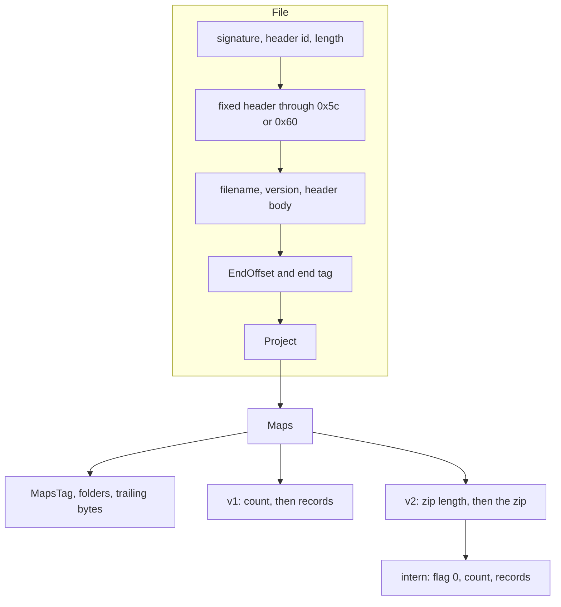

# KP format

WinOLS map pack (`*.kp`), read and written by `kp/`. Integers are little-endian. A string is an int32 byte count, that many ISO-8859-15 bytes, and a NUL. A zero count has no NUL.

The Go structs are the record layouts. `kp/codec.go` walks fields in declaration order; the tag grammar is at the top of that file. JSON names are those fields with a lower-case first letter. `kp-defaults.json` uses the JSON names (`model.md`).

## Versions

| Layout | Header id at 0x10 | Value at 0x14 | Fixed header ends | Maps |
| --- | --- | --- | --- | --- |
| v1 | 0x71 or 0x74 | 0 | 0x5c | inline |
| v2 | 0x124 or 0x149 | file length | 0x60 | zip entry `intern` |

0x149 is accepted. The archived packs use 0x124. WinOLS 2.24 writes v2 with header id 0x124 and version string `OLS 5.0 (Windows)`. The filename string is the name the file was exported under, usually upper case.

Every archived pack ends with `33 88 72 98`. `EndOffset` is the offset of that marker (file length minus 4). WinOLS imports a file whose length changed without updating `EndOffset`, and raises its crash-report dialog.

## Layout



The bytes from 0x18 to the end of the fixed header are zeros (`FixedHeader`). The header between the version string and `EndOffset` is `HeaderBody`. Both, and `Project.Trailing`, are kept raw. They change between saves and are not map data. The header walk is `kp.walkHeader`.

After `EndOffset`:

- `EndTag`, 12 bytes: `00 00 00 00 99 78 00 42 02 00 00 00`
- Project name, int32[4] `NameTag`, v2 `NamePad` (4 zeros)
- Project version, int32[4] `VersionTag` (equal to `NameTag`), v2 `VersionPad` (4 zeros)
- int32 `Build`, v2 `BuildFlag` (1)

`NameTag`, `VersionTag`, `Build`, and `MapsTag` are the same in every archived pack and in WinOLS 2.24 exports, including an empty project.

Maps, then int32[3] `MapsTag`, then the folder table:

- v1: int32 count, then the map records
- v2: int32 zip length, then the zip. The folder table follows the zip. The inflated `intern` entry is one byte 0 (`InternFlag`), an int32 count, then the map records

Each folder is int32 id, int32 `BuiltIn`, name, 2 bytes `Flags` (`01 01`), int32 `Style` (`0x1000000`), and in v2 15 zero bytes `Pad`. `BuiltIn` is 9000 on My maps, 9001 on Hexdump, and 0 on every other folder. mapdump sorts folders by name, drops duplicate names, and renumbers folder ids. This reader keeps the table as stored.

## Round trip

`Parse` and `Encode` share one walk, so every byte is a field or a raw block. Encode writes the v2 length at 0x14 and `EndOffset` back into the `File`.

- v1: parse then encode is byte-identical, including JSON in between
- v2: the original zip is reused while the map block is unchanged. A changed block is re-deflated with Go `compress/flate` at level 9. The inflated block, and the file outside the zip, match aside from the two lengths

Decoding fails when a bool is not 0 or 1, a string has no NUL, a free-editable list length is not a multiple of 4, or bytes remain after the v2 maps.

## v2 zip

One local entry, name `intern`, method 8, general-purpose flag 2, DOS date and time zero, version 20. The archived streams match zlib 1.2.x raw deflate at level 9, memLevel 8, window 15. WinOLS 2.24 links zlib 1.2.3. Go's deflate differs, so a rewritten file must update the zip length, the length at 0x14, and `EndOffset`. WinOLS 2.24 imports those files.

## Map

Order is the `kp.Map` struct. v2-only fields are marked.

| Field | Type | |
| --- | --- | --- |
| `Marked` | byte | 0 or 1. WinOLS map-list marker (Insert/delete marker; filter Only marked / Only unmarked). Confirmed on TLDOBAN-50a / 51-marker / 52-unmarker in `testdata/local/outgoing/sweep/`. Model `vislevel` 1 when set, else 0 |
| `LinkID` | int32, v2 | |
| `Comment` | string, v2 | |
| `CommentFlag` | byte, v2 | |
| `Name` | string | long description |
| `Organization` | int32 | [Enums](#enums) |
| `RightPane` | int32 | |
| `Type` | int32 | element type; [Enums](#enums) |
| `Width` | int32 | element size in bytes; matches `Type` |
| `Base` | int32 | 10, 16, or 2 |
| `FolderID` | int32 | |
| `ID` | string | short name. mapdump drops anything after a space or `?` |
| `IDPad` | int32 | 0 |
| `IDFlag` | byte | 0 |
| `IDState` | int32, v2 | 0 or 1. Meaning unconfirmed; often constant per pack. Residue only (not in the model). Was wrongly named Marked before the map-list marker was confirmed |
| `Range` | int64[3][2] | [below](#range) |
| `Reciprocal`, `Signed`, `Difference`, `Percent` | byte | 0 or 1, in that order |
| `Cols`, `Rows` | int32 | |
| `Cursor` | int32[2] | changes when the map is opened |
| `Precision` | int32 | |
| `Value` | | description, units, float64 factor, float64 offset |
| `Start`, `End` | int32 | [below](#addresses) |
| `ImageSize` | int32 | image length |
| `ImageSizePad` | int32[2], v2 | 0 |
| `Addr2` | int32 | [below](#addresses) |
| `Addr2Flags` | int32[2] | |
| `Addr2ImageSize` | int32 | image length, or 0 |
| `Addr2Pad` | int32 | 0 |
| `X`, `Y` | axis | [Axis](#axis) |

### Range

Three low/high pairs, in order: 8-bit, 16-bit, 32-bit. WinOLS writes the pair for the map's width, as typed in Value range. An 8-bit map uses the first pair (TLDOBAN, 10 to 90). A 16-bit map uses the second (NMAX, 1000 to 6000; KFMIOP, 10 to 90). Defaults are 0 and 255, 0 and 65535, 0 and 4294967295. A negative low is sign-extended.

Without a template, the pair for the map's width is the model's min and max when both are set, ordered low to high. Otherwise it is the conversion of the raw endpoints, rounded to integers. A reciprocal conversion maps the low raw value to the high physical value, so those ends are ordered after the conversion. The other two pairs stay at the defaults.

### Addresses

`End` is `Start` plus the map's byte length, one past the last byte. WinOLS recomputes a stale end on export. `xdfkit fix` rule R8 does the same (`autocorrect.md`).

`ImageSize` is the image length: `0x100000` in most archived packs, `0x20000` in 8D0907558E, `0x40000` in 8D0907558M.

Moving a map or duplicating it sets `Addr2` to the new start.

### Storage order

`StoredCols` then `StoredRows` follow `Cols` and `Rows`, swapped on organisation 5 (2D inverse). xdfkit reads the cells row-major and writes the swapped pair for organisation 5.

### Tail

The 80 bytes after the Y axis:

| Offset | Field | Type | |
| --- | --- | --- | --- |
| 0x00 | `YFlag` | int32 | |
| 0x04 | `YPad` | int16 | 0 |
| 0x06 | `StoredCols` | int32 | [Storage order](#storage-order) |
| 0x0A | `StoredRows` | int32 | |
| 0x0E | `ViewMode` | int32 | 1 text, 2 2D, 3 3D |
| 0x12 | `ViewFlags` | byte[2] | |
| 0x14 | `View2DScale` | float64[2] | |
| 0x24 | `View2DRef` | int32 | |
| 0x28 | `ViewFlag` | byte | |
| 0x29 | `View3DRotation` | float64[2] | |
| 0x39 | `ViewScale` | float64 | |
| 0x41 | `ViewScaleRef` | int32 | |
| 0x45 | `ViewOffset` | float64 | |
| 0x4D | `Term2` | byte[3] | 1, 1, 1. The first two must be 1 |

Opening a map in WinOLS can change `Cursor`, `Marked`, and `ViewScale`.

## Axis

Both records are stored on every map. WinOLS uses X for a 1D map, X and Y for a 2D map, and neither for a single value.

| Field | Type | |
| --- | --- | --- |
| `Value` | | description, units, factor, offset |
| `DataSource` | int32 | [Enums](#enums). Address matters for image sources |
| `Addr` | int32 | |
| `Type`, `Width`, `Base` | int32 | `Width` is the element size in bytes |
| `Mirror` | v2 int32, v1 byte | 0 or 1. [below](#mirror) |
| `MirrorPad` | 9 bytes, v2 | zeros |
| `Reciprocal` | byte | |
| `Precision` | int32 | |
| `Signed` | byte | |
| `Values` | length, then bytes | [below](#free-editable) |
| `DataHeader` | int32 | |
| `SignatureByte` | int32 | -1 is the usual value |

### Mirror

WinOLS "&Mirror map". The image stays in stored order. WinOLS shows the axis, and the cells along it, from the high end. mapdump treats the flag as undefined and drops that axis's units and scale, so its CSV differs in those columns.

### Free editable

Datasource 4. `Values` is 4 bytes per point, with the breakpoint in the element type at the start of each group. Setting an 8-bit axis to 1..8 writes 32 bytes (`01` through `08`, then zeros), clears the address, and sets the factor to 1. Datasource 5 (EEPROM backwards) clears the list.

In v2 the list is empty except on free-editable axes. In v1 both axis records hold zeros, 4 bytes per stored row, on almost every map.

## Enums

| Field | Values |
| --- | --- |
| Organisation | 2 single, 3 1D, 4 2D, 5 2D inverse |
| Value type | 1 8-bit, 2 16-bit HiLo, 3 16-bit LoHi, 4 32-bit HiLo, 5 32-bit LoHi, 6 float HiLo, 7 float LoHi |
| Data source | 0 ordinal, 1 EEPROM, 2 EEPROM add, 3 EEPROM subtract, 4 free editable, 5 EEPROM backwards |
| Display base | 10, 16, 2. An omitted base is written as 10. WinOLS crashes when a map whose base is 0 is opened. |

Datasource 4 and 5 are free editable then EEPROM backwards. The WinOLS UI lists those two in the other order.

## EEPROM, subtract

Datasource 3 stores the gaps between breakpoints, counted down from the top of the range. For an 8-bit axis, displayed point i is

```text
conversion(256 - (raw[i] + raw[i+1] + ... + raw[n-1]))
```

with no wrap. The last raw value is the gap from the last point to 256.

FHSA.0 X in 8D0907558E, raw 27, 13, 12, 60, factor 0.75, offset -48, displays 60, 80.25, 90, 99.

The label in a pack can be wrong either way. KFFA X in 8D0907558E is a subtract axis labelled EEPROM (1.0, 1.6, 2.2, ..., 11.0 ms/rev once relabelled). KFWKSTAB X in 8D0907551M is an absolute axis labelled subtract. Rules R1 and R2 relabel these (`autocorrect.md`).

On M3 images the two bytes before one of these axes are the variable id and the point count.

The model keeps `axis.stored` as written (`absolute`, `add`, `subtract`, or `backwards`). The XDF writer emits static labels computed from the image. Without an image it emits a plain image axis.

## WinOLS 2.24 exports

Compared with an imported pack:

- Header id 0x124 and version `OLS 5.0 (Windows)`, as [above](#versions)
- `End` rewritten to start plus byte length where the pack had a stale end
- `Cursor`, `Marked`, and `ViewScale` changed on maps opened in the session
- The `intern` stream matches zlib level 9, memLevel 8, as in the archived packs
